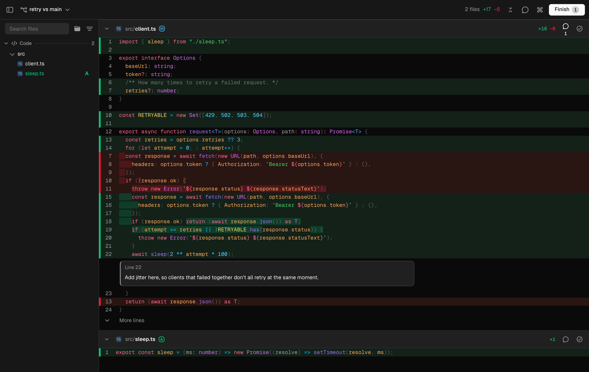

# Patch

Review your coding agent's changes in the browser, the way you'd review a pull
request. Comment on lines, press **Finish**, and the agent gets your comments.



Patch only reads your repository. It never writes to it.

## Install

```sh
npx -y @phongndo/patchr install
```

Or without Node:

```sh
curl -fsSL https://github.com/phongndo/patch/releases/latest/download/install.sh | sh
```

This sets up Patch in every supported agent it finds on your machine. Restart
any open agent sessions afterwards. Patch runs on macOS and Linux.

<details>
<summary>Other ways to install</summary>

```sh
mise use -g github:phongndo/patch && mise exec -- patchr install
brew install phongndo/tap/patchr && "$(brew --prefix)/bin/patchr" install
nix profile add github:phongndo/patch && ~/.nix-profile/bin/patchr install
```

</details>

## Use

1. Ask your agent to make a change.
2. Type `/patch` (`$patch` in Codex and Amp). A review opens in your browser.
3. Comment on lines, files, or the change as a whole.
4. Press **Finish** (⌘↵). Your comments go to the agent, and the tab closes.

Type `/patch` again after the agent makes its fixes. If everything looks good,
press **Finish** without commenting.

The review shows what a pull request would: your branch's commits plus any
uncommitted and untracked files. Press ⌘O to review something else: only
uncommitted or staged changes, a range of commits, or an open pull request.

## Supported agents

| Agent                                                          | Command  |
| -------------------------------------------------------------- | -------- |
| Claude Code, Pi, OpenCode 2, Gemini CLI, Cursor, Factory Droid | `/patch` |
| Codex, Amp                                                     | `$patch` |

Installed an agent later? Run `patchr install` again.

Codex asks you to trust Patch's hook the first time. Until you do, its sandbox
may block Patch; allow it when asked.

## Settings and shortcuts

Press ⌘K (Ctrl+K off a Mac) for the command palette: every file, comment,
command, and setting, including themes and keyboard shortcuts.

## Review from another device

If the machine running your agent is signed in to
[Tailscale](https://tailscale.com), the link Patch prints also opens on your
other devices on the same tailnet, such as your laptop or phone. This is handy
when your agent runs on a remote server.

Treat the link like a password. Pass `--local` (or set `PATCH_REMOTE=0`) to
keep the review on the machine itself.

## Update and uninstall

Run `patchr update` to update Patch, and `patchr uninstall` to remove it. Run
`patchr --help` for all commands and options.

## Contributing

See [CONTRIBUTING.md](https://github.com/phongndo/patch/blob/main/CONTRIBUTING.md).

## License

Patch is [MIT-licensed](LICENSE). Bundled dependencies and themes keep their own
licenses; release archives include them in `THIRD_PARTY_NOTICES.md`.
